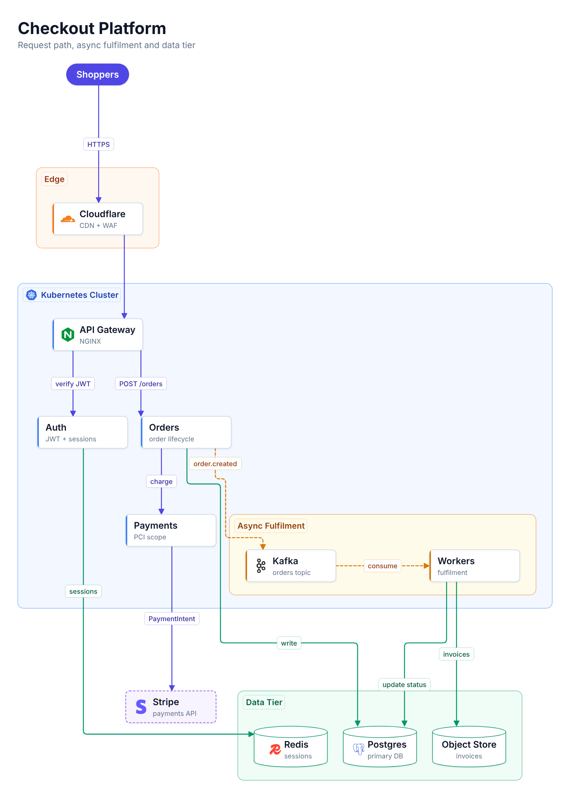
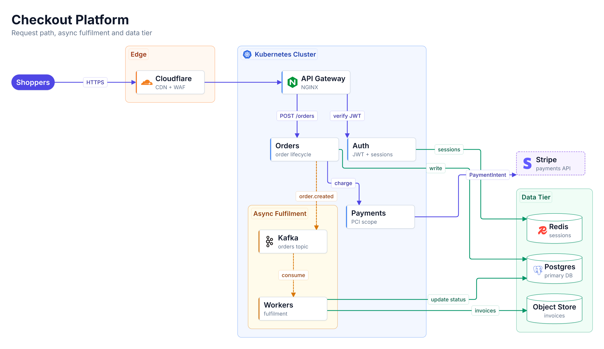
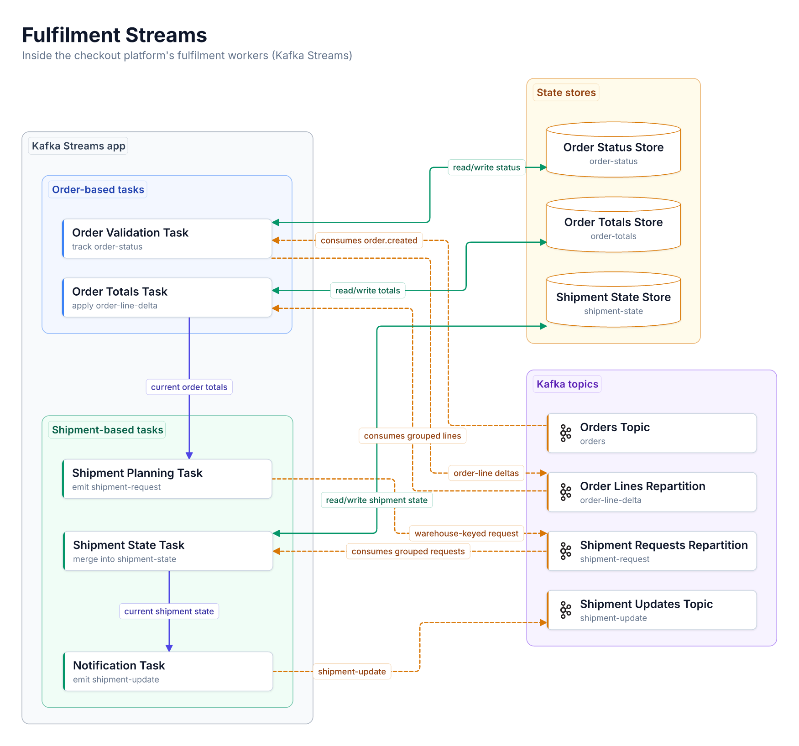

# archdiag (beta)

Architecture diagrams from code, rendered like a hand-placed Lucidchart, with a plain-text version for Slack.

```
diagram.yaml ──► layout (elkjs, compound) ──► routing (libavoid) ──► labels ──┬─► SVG / PNG
                                                                             └─► Unicode / ASCII text
```

## Examples

One source file, [`examples/checkout.yaml`](examples/checkout.yaml), rendered three ways with no hand tweaks.
All outputs are in [`examples/output/`](examples/output/).

### Doc / README (`--fit doc --type 1.3`)



### Slide, 16:9 (`--fit slide --type 1.6`)



### Slack / terminal text (`--ascii unicode --cols 100`)

Paste inside a triple-backtick block. A plain-ASCII version (`--ascii ascii`) is in
[`checkout-ascii.txt`](examples/output/checkout-ascii.txt).

<details>
<summary>Show the text output (78 columns × 112 rows)</summary>

```
Checkout Platform

              ╭──────────╮
              │ Shoppers │
              ╰──────────╯
                    │
                    │
                    │
                    │
                    │
                    │
                    │
                    │ HTTPS
                    │
                    │
                    │
                    │
        ┌┈ Edge ┈┈┈┈│┈┈┈┈┈┈┈┈┈┈┈┐
        ┊           ▼           ┊
        ┊  ┌─────────────────┐  ┊
        ┊  │   Cloudflare    │  ┊
        ┊  │    CDN + WAF    │  ┊
        ┊  └─────────────────┘  ┊
        └┈┈┈┈┈┈┈┈┈┈┈┈┈┈│┈┈┈┈┈┈┈┈┘
                       │
                       │
                       │
                       │
                       │
                       │
┌┈ Kubernetes Cluster ┈│┈┈┈┈┈┈┈┈┈┈┈┈┈┈┈┈┈┈┈┈┈┈┈┈┈┈┈┈┈┈┈┈┈┈┈┈┈┈┈┈┈┈┈┈┈┈┈┈┈┈┈┈┈┐
┊                      ▼                                                     ┊
┊          ┌─────────────────┐                                               ┊
┊          │   API Gateway   │                                               ┊
┊          │      NGINX      │                                               ┊
┊          └─────────────────┘                                               ┊
┊              │              │                                              ┊
┊              │              │                                              ┊
┊              │              │                                              ┊
┊              │              │                                              ┊
┊              │              │                                              ┊
┊              │ verify JWT   │ POST /orders                                 ┊
┊              │              │                                              ┊
┊              │              │                                              ┊
┊              │              │                                              ┊
┊              ▼              ▼                                              ┊
┊       ┌─────────────────┐  ┌─────────────────┐                             ┊
┊       │      Auth       │  │     Orders      │                             ┊
┊       │ JWT + sessions  │  │ order lifecycle │                             ┊
┊       └─────────────────┘  └─────────────────┘                             ┊
┊            │                    │    │     ┆                               ┊
┊            │                    │    │     ┆                               ┊
┊            │                    │    │     ┆                               ┊
┊            │                    │    │     ┆                               ┊
┊            │             charge │    │     └┄┄┄ order.created ┄┄┄┄┐        ┊
┊            │                    │    └───────┐                    ┆        ┊
┊            │                    │            │                    ┆        ┊
┊            │                    │            │                    ┆        ┊
┊            │                    ▼            │                    ┆        ┊
┊            │            ┌─────────────────┐  │┌┈ Async Fulfilment ┆┈┈┈┈┈┐  ┊
┊            │            │    Payments     │  │┊                   ▼     ┊  ┊
┊            │            │    PCI scope    │  │┊    ┌─────────────────┐  ┊  ┊
┊            │            └─────────────────┘  │┊    │      Kafka      │  ┊  ┊
┊            │                 │               │┊    │  orders topic   │  ┊  ┊
┊            │                 │               │┊    └─────────────────┘  ┊  ┊
┊            │                 │               │┊             ┆           ┊  ┊
┊            │                 │               │┊             ┆           ┊  ┊
┊            │                 │               │┊             ┆           ┊  ┊
┊            │                 │               │┊             ┆           ┊  ┊
┊            │                 │               │┊             ┆           ┊  ┊
┊            │                 │               │┊             ┆ consume   ┊  ┊
┊            │                 │               │┊             ┆           ┊  ┊
┊            │                 │               │┊             ┆           ┊  ┊
┊            │                 │               │┊             ┆           ┊  ┊
┊            │                 │               │┊             ▼           ┊  ┊
┊            │                 │               │┊    ┌─────────────────┐  ┊  ┊
┊            │                 │               │┊    │     Workers     │  ┊  ┊
┊            │                 │               │┊    │   fulfilment    │  ┊  ┊
┊            │                 │ PaymentIntent │┊    └─────────────────┘  ┊  ┊
┊            │                 │               │└┈┈┈┈┈┈┈┈┈┈┈┈┈┈┈┈│┈│┈┈┈┈┈┈┘  ┊
└┈┈┈┈┈┈┈┈┈┈┈┈│┈┈┈┈┈┈┈┈┈┈┈┈┈┈┈┈┈│┈┈┈┈┈┈┈┈┈┈┈┈┈┈┈│┈┈┈┈┈┈┈┈┈┈┈┈┈┈┈┈┈│┈│┈┈┈┈┈┈┈┈┈┘
             │                 │               │                 │ │
             │                 │               │                 │ │
             │                 │               │   update status │ │
             │                 │               │                 │ │
             │                 │               │                 │ │
             │                 │               │                 │ │
             │                 │               └─── write ───┐  ┌┘ │
             │                 │                             │  │  │
             │                 │                             │  │  │
             │                 │                             │  │  │
             │                 │                             │  │  │
             │                 ▼                             │  │  │
             │  ┌╌╌╌╌╌╌╌╌╌╌╌╌╌╌╌╌╌┐      ┌┈ Data Tier ┈┈┈┈┈┈┈│┐ │  │
             │  ╎     Stripe      ╎      ┊                   │┊ │  │ invoices
             │  ╎  payments API   ╎      ┊  ╭──────────────╮ │┊ │  │
             │  └╌╌╌╌╌╌╌╌╌╌╌╌╌╌╌╌╌┘      ┊  │    Redis     │ │┊ │  │
             └───────── sessions ──────────▶│   sessions   │ │┊ │  │
                                         ┊  ╰──────────────╯ │┊ │  │
                                         ┊                   │┊ │  │
                                         ┊                   │┊ │  │
                                         ┊  ╭──────────────╮ │┊ │  │
                                         ┊  │   Postgres   │◀┘┊ │  │
                                         ┊  │  primary DB  │◀───┘  │
                                         ┊  ╰──────────────╯  ┊    │
                                         ┊                    ┊    │
                                         ┊                    ┊    │
                                         ┊  ╭──────────────╮  ┊    │
                                         ┊  │ Object Store │◀──────┘
                                         ┊  │   invoices   │  ┊
                                         └┈┈╰──────────────╯┈┈┘
```

</details>

### A Kafka Streams app: lanes and real data direction

[`examples/fulfilment-streams.yaml`](examples/fulfilment-streams.yaml) zooms into the checkout platform's fulfilment
workers: the app on the left, the topics and state stores it uses on the right (`lane`), topics flowing into the tasks
that consume them, and state stores read and written (`<->`). Doc layout:



The slide version is [`fulfilment-streams-slide.png`](examples/output/fulfilment-streams-slide.png). There's no text
version yet: two columns don't fit 100 characters, and the stacked version isn't readable.

To regenerate all of them (`npm run examples` does the same):

```bash
node src/cli.js examples/checkout.yaml examples/output/checkout-doc   --fit doc   --type 1.3 --png --png-scale 1
node src/cli.js examples/checkout.yaml examples/output/checkout-slide --fit slide --type 1.6 --png --png-scale 1
node src/cli.js examples/checkout.yaml examples/output/checkout-text  --ascii unicode --cols 100
node src/cli.js examples/checkout.yaml examples/output/checkout-ascii --ascii ascii   --cols 100
node src/cli.js examples/fulfilment-streams.yaml examples/output/fulfilment-streams-doc   --fit doc   --type 1.3 --png --png-scale 1
node src/cli.js examples/fulfilment-streams.yaml examples/output/fulfilment-streams-slide --fit slide --type 1.6 --png --png-scale 1
```

## Why it looks cleaner than D2 / Mermaid

- **Compound layout with lifted edges.** Each zone is laid out on its own with ELK in its own direction;
  one level up, the zone is a single box and the real edges are "lifted" onto it, so the big picture follows the flow.
  A lifted edge attaches to a port where the real inner box sits, and inside a zone that flows across its
  parent, boxes whose links leave the zone are placed on the exit side, so lines don't cut across the zone.
- **Separate connector routing (libavoid).** Placement and routing are separate steps, the way Lucidchart and Visio
  smart connectors work. Pins are flow-aware (lines leave a box on the side facing the flow), unrelated zones are
  obstacles, shared trunks are penalised, and small doglegs are straightened.
- **Alignment pass.** Neighbouring zones slide so connected boxes line up (Shoppers → Cloudflare → Gateway is one straight line).
- **Labels go on their own stretch of line**, never on a segment another connector shares, and never over a box.
- **Design system in one file** (`src/theme.js`): type scale, card sizes, colours and spacing. Type size is
  independent of spacing (`--type`), so a slide can have big text without huge gaps.
- **Auto-fit.** `--fit slide|doc` tries every combination of zone directions and keeps the one with the biggest
  on-screen text, fewest crossings and fewest bends.

## The one-shot pipeline (what happens on every render, no hand tweaks)

1. **Measure** every label with the real font, and give same-kind boxes one size.
2. **Lay out each zone on its own** (ELK), inside-out, in that zone's direction. Edges between zones are
   "lifted" onto the zone boxes, so the overall arrangement follows the real flow.
3. **Align** neighbouring zones so connected boxes sit in a straight line.
4. **Route connectors** with libavoid: flow-aware pins (leave a box facing the flow, enter mildly
   preferring the opposite side), zones and zone titles as obstacles, shared trunks penalised, then
   straighten small doglegs.
5. **Quality gate.** Check every connector against these rules:
   - doesn't touch any box except its own two (with clearance)
   - doesn't enter a zone it has nothing to do with
   - doesn't run along the border of its own zone
   - doesn't cross a zone title, or squeeze between a zone's corner and its title
   A connector that fails is re-routed alone, with exactly the obstacles it must avoid. Overlapping parallel
   lines are pulled apart. Titles never move: every zone has a title row (margin, title, turn lane) so
   lines come in beside the title and turn under it, as you'd draw it in Lucidchart.
6. **Make room.** If anything still fails, widen the gaps and redo steps 2-5 (up to two more times).
7. **Auto-fit.** All of this runs for every combination of zone directions. The layout kept is the one with
   zero rule breaks, then the biggest readable text for the target (slides need at least ~14px), then the
   fewest crossings and bends.
8. **Labels** go on a stretch of line that belongs only to their connector, clear of boxes and titles.

The YAML only says *what* connects to what. You don't position anything. The CLI prints any remaining
rule breaks, so problems are reported, not discovered by eye.

## Use it in your project

archdiag is in beta (`0.1.0-beta.0`). Once it's on npm, install it with `npm install -D archdiag@beta`. Until
then, install it as a dev dependency from GitHub:

```bash
npm install -D github:dfbernal/archdiag#v0.1.0-beta.0      # from GitHub (needs git; see below)
npm install -D https://github.com/dfbernal/archdiag/releases/download/v0.1.0-beta.0/archdiag-0.1.0-beta.0.tgz
                                                           # from the release tarball (no git needed)
npm install -D ../archdiag                                 # from a local checkout (run npm install there once)

# Describe your system in YAML (format below), then render:
npx archdiag docs/architecture.yaml docs/architecture --fit doc --type 1.3 --png   # README image (SVG + PNG)
npx archdiag docs/architecture.yaml docs/arch-slide --fit slide --type 1.6 --png   # 16:9 slide
npx archdiag docs/architecture.yaml docs/architecture --ascii unicode --cols 100   # Slack / terminal text
```

Everything archdiag needs comes from the npm registry: six packages, about 23 MB installed. PNGs are
rendered with [resvg](https://github.com/linebender/resvg), whose native binary is itself an npm package for
your platform, so there's no browser to download. `--png-engine chromium` still renders through Playwright if you
prefer (`npm install -D playwright && npx playwright install chromium`).

### Installing behind a corporate network

- **Use the release tarball, not `github:`.** npm installs `github:` URLs by running `git`, which ignores npm's
  proxy and registry settings. The tarball URL is a plain HTTPS download that goes through npm's own proxy settings.
  If you must use git, give git the proxy too: `git config --global http.proxy http://proxy.example.com:8080`.
- **The dependencies come from your registry mirror** (Artifactory, Nexus, ...) like any other package, including
  resvg's platform binary (`@resvg/resvg-js-<platform>`). If your mirror blocks that one, PNG output fails with a
  clear error; SVG and text output still work, or use `--png-engine chromium`.
- **TLS-inspecting proxies:** if npm fails with certificate errors, point it at your company's CA:
  `npm config set cafile /path/to/corp-ca.pem` (and `NODE_EXTRA_CA_CERTS=/path/to/corp-ca.pem` for Node itself).

- Needs Node 18+. Outputs: `<prefix>.svg`, `<prefix>.png` (with `--png`, 2× by default, `--png-scale 1`),
  `<prefix>.txt` (text mode) and `<prefix>.layout.json` (positions, for debugging).
- **Icons:** `icon: name` looks for `name.svg` in `--icons <dir>`, then in an `icons/` folder next to your YAML,
  then in archdiag's built-in set (cloudflare, grafana, kafka, kubernetes, minio, nginx, postgresql, redis, stripe).
- **For GitHub READMEs, commit the PNG.** The SVG names the Inter font but doesn't embed it, so on a machine
  without Inter the text falls back to Helvetica/Arial and can overflow its boxes. The PNG always uses Inter.
- Add a script so the diagram is re-rendered with the docs: `"diagram": "archdiag docs/architecture.yaml docs/architecture --fit doc --type 1.3 --png"`.
- The CLI prints any remaining rule breaks on stderr; an empty report means the layout passed every check.
- The patched libavoid build ships as plain files in `vendor/libavoid-js/` (see PATCHED.md there), not as an npm
  dependency, so every install method above behaves the same. `npm pack` still makes a tarball if you want one.

## Usage (from this folder)

```bash
npm install
# Slide (16:9), text 1.6x the base size
node src/cli.js examples/checkout.yaml out/slide --fit slide --type 1.6
# README / doc page (fits a ~1600px column)
node src/cli.js examples/checkout.yaml out/doc --fit doc --type 1.3
# Slack / terminal text (Unicode box drawing, or --ascii ascii for plain ASCII)
node src/cli.js examples/checkout.yaml out/slack --ascii unicode --cols 100
# Zones as libavoid clusters instead of obstacles (~25x slower)
node src/cli.js examples/checkout.yaml out/doc --fit doc --type 1.3 --zones cluster
# Print every route and repair (debugging)
ARCHDIAG_DEBUG=1 node src/cli.js examples/checkout.yaml out/doc --fit doc --type 1.3
# Manual control instead of auto-fit
node src/cli.js examples/checkout.yaml out/x --engine compound --direction right --gdir k8s=down --gdir async=right
```

Output: `<prefix>.svg` (open in a browser, or convert to PNG with any headless browser) and `<prefix>.txt`.
The CLI prints width/height and the node text size you'd get on a 1920×1080 slide.

## Diagram format

```yaml
title: Checkout Platform
subtitle: Request path, async fulfilment and data tier
groups:
  k8s:   { label: Kubernetes Cluster, color: blue, icon: kubernetes }
  async: { label: Async Fulfilment, color: amber, parent: k8s, direction: down }
nodes:
  gw:    { label: API Gateway, sub: NGINX, group: k8s, icon: nginx }
  pg:    { label: Postgres, sub: primary DB, group: data, kind: datastore }
  # kinds: service (default), datastore, queue, external, actor
edges:
  - gw -> orders: { label: POST /orders }               # style: request (default)
  - orders -> kafka: { label: order.created, style: async }
  - orders -> pg: { label: write, style: data }
```

Colours: blue, orange, amber, green, violet, slate. Icons: any SVG in `icons/` by file name.

### Edges

```yaml
edges:
  - topic -> task: { label: consumes }      # arrow at the target; data flows source -> target
  - task -> topic: { label: produces }
  - task <-> store: { label: read/write }   # arrowheads at both ends
  - a -- b: { label: related }              # no arrowheads
  - a -> b: { arrow: back }                 # forward | back | both | none: changes the drawing only
```

Write edges the way the data actually moves. The layout follows `source -> target`; `arrow:` and the
`<->` / `--` forms only change how the line is drawn.

### Where lines attach

By default the router picks the side of a box each line uses and the order of lines along it. You can pin either
end of an edge to a side, and order the lines that share it:

```yaml
edges:
  - input -> flatten:  { label: consumes events, target-side: left, target-order: 1 }
  - flatten -> deltas: { label: signed deltas,   source-side: left, source-order: 2 }
```

- `source-side` / `target-side`: `left`, `right`, `top` or `bottom`. The line must attach there.
- `source-order` / `target-order`: `1`, `2`, ... among the lines on that side that have an order. `1` is the top-most
  line on a left or right side, the left-most on a top or bottom side. Lines without an order fit in around them.
- "source" is always where the data comes from (also in `a <- b`), and "target" where it goes.
- These are requirements, not hints: if keeping them costs a crossing, it costs a crossing. `--check` reports any
  line that ends up on another side (`side`) or out of order (`order`).

### Lanes: fixing where zones go

`lane: N` on a zone (or a box) pins it to the Nth band along its container's flow: with the diagram
flowing left to right, lane 1 is the left column, lane 2 the next, and so on. Zones in the same lane stack.
Edges may run backwards between lanes (a task in lane 1 consuming a topic in lane 2); they leave and enter on
the sides that face each other.

```yaml
groups:
  app:    { label: Kafka Streams app, lane: 1 }
  topics: { label: Kafka topics, lane: 2 }
  stores: { label: State stores, lane: 2 }
```

### Render options

Put the options you'd pass on the command line in a `render:` block; command-line flags override them.

```yaml
render:
  direction: right   # lock the overall direction (auto-fit then only varies the zones' directions)
  fit: doc           # doc | slide
  type: 1.3          # text size multiplier
  png: true          # also write a PNG
  pngScale: 2
  pngEngine: resvg   # resvg (default) | chromium
  weights: { crossings: 1.6, bends: 0.1, length: 1, violations: 4 }   # auto-fit scoring, per unit
```

Auto-fit scores each candidate: on-screen text size (1 point per px) minus crossings, bends, average line
length (in box widths) and rule breaks, each times its weight.

### Labels

A label sits on its own line, in this order of preference: never on a box, a zone title, another label or an
arrowhead; then avoid a zone's edge most; then avoid sitting inside a zone the line only passes through; then
avoid covering other lines. Among what's left, the middle of a long horizontal run wins. Labels with the fewest
good spots are placed first. Parallel lines are spaced at least one label's height apart so each has room.

### Checking in CI

`--check` prints one JSON object (`ok`, `violations`, `crossings`, `bends`, size) and exits with code 1 if any
rule is broken. Rules: a line may not touch any box but its own two, run along its own boxes' edges, enter a
zone it has nothing to do with, run along its own zone's border, or cross a zone title. The canvas always
grows to include every line and label, so nothing is clipped.

## Known limitations (beta)

- Text output for two-column (lane) diagrams: side by side is too wide for Slack, and stacked is hard to read.
- In a stacked column of boxes, a line can still squeeze through the narrow gap between two boxes to reach the
  one it targets; no rule flags that yet.

- Zones are obstacles. `--zones cluster` uses libavoid's real `ClusterRef` (patched build in `vendor/`), but its
  clusters are a crossing penalty, not clearance, so it's slower and wasn't better here. Either way a line
  can still run ~10px outside a zone edge on its way in (the checker only flags < 8px).
- libavoid-js is a patched local build (`vendor/libavoid-js/`): ClusterRef bindings plus a libavoid fix that makes
  pin costs apply at the target end of a connector. See `vendor/libavoid-js/PATCHED.md`.
- Dense diagrams (12+ nodes with sub-labels) land around 16px on a slide; split the diagram or drop sub-labels for talks.
- Text mode can leave long vertical runs; a compaction pass would tighten it.
- No interactive editing yet. The natural next step is a React Flow canvas where dragging a box writes a position hint back into the YAML.

## Licence and releases

archdiag is released under the [MIT licence](LICENSE). It bundles a patched libavoid (LGPL-2.1-or-later) and the
Inter font (SIL OFL 1.1), which keep their own licences: see [THIRD-PARTY-NOTICES.md](THIRD-PARTY-NOTICES.md).
How releases are published to npm: [RELEASING.md](RELEASING.md).
